# Home Appliance Manual RAG

A home-appliance manual Q&A website built with .NET 10, Blazor Interactive Server, PostgreSQL/pgvector, Docling, and Azure OpenAI.

This project was vibe-coded using GitHub Copilot App and GPT-6 Luna (`gpt-6-luna`).

## Features

- Visitors can query public manuals; signed-in users can query their own manuals; administrators can manage all documents and indexing jobs.
- PDF upload and indexing, semantic and multilingual lexical retrieval, and streamed answers with page citations.
- English and Traditional Chinese UI; chat history is isolated by account or anonymous access key.
- See [SPEC.md](SPEC.md) for requirements, authorization, data model, and security details, and [TASKS.md](TASKS.md) for implementation status.

## System flow

The diagram shows the PDF ingestion and grounded question-answering paths. Retrieval scopes are enforced server-side.

```mermaid
flowchart TD
  subgraph Ingestion["PDF ingestion and indexing"]
    Upload["Admin or user uploads PDF"] --> Validate{"Authorized and valid PDF?"}
    Validate -->|No| UploadRejected["Reject upload"]
    Validate -->|Yes| Save["Store PDF and Pending document"]
    Save --> Job["Create durable indexing job"]
    Job --> Parse["Docling extracts page-aware content; OCR fallback when needed"]
    Parse --> Classify["TypeSafe Jev classifies appliance manual"]
    Classify -->|Not a manual| Rejected["Mark Rejected; exclude from retrieval"]
    Classify -->|Classifier unavailable| IndexFailed["Mark Failed with actionable error; allow retry"]
    Classify -->|Manual| Metadata["Extract appliance metadata"]
    Metadata --> Chunk["Create structure-aware chunks with page provenance"]
    Chunk --> Embed["Generate Azure OpenAI embeddings"]
    Embed --> Dimension{"Embedding dimensions match?"}
    Dimension -->|No| IndexFailed
    Dimension -->|Yes| Persist["Atomically replace chunks and mark Ready"]
    Parse -->|Parse failure| IndexFailed
    Embed -->|Provider failure| IndexFailed
    Metadata -.->|Extraction failure is non-blocking| Chunk
  end

  subgraph Chat["Question and answer"]
    Ask["Visitor or signed-in user asks a question"] --> Preflight["TypeSafe Jev checks current question"]
    Preflight -->|Blocked| Blocked["Return localized blocked response"]
    Preflight -->|Unavailable or invalid| PreflightError["Fail closed; return temporary error and record diagnostic"]
    Preflight -->|Accepted| Scope{"Choose authorized document scope"}
    Scope -->|Anonymous| Public["Admin public manuals"]
    Scope -->|Normal user| Owned["Current user's manuals"]
    Scope -->|Admin| AllDocs["Explicit admin scope"]
    Public --> Search["SQL filters by Ready status and scope; vector and lexical search"]
    Owned --> Search
    AllDocs --> Search
    Search --> Fuse["Fuse candidate ranks"]
    Fuse --> HasContext{"Relevant context found?"}
    HasContext -->|No| NoAnswer["Prepare explicit no-answer response"]
    HasContext -->|Yes| Generate["Azure OpenAI streams a grounded answer"]
    Generate --> Verify["Validate answer citations against retrieved context"]
    Verify --> Respond["Display final answer and validated citations, if any"]
    NoAnswer --> Respond
    Respond --> History["Persist conversation messages for the owner or anonymous access key"]
  end
```



## Local setup

### Prerequisites

- Docker Desktop
- .NET 10 SDK (only if running the web app directly on the host)
- Azure OpenAI and TypeSafe configuration for full indexing and chat functionality

### Run with Docker Compose

```powershell
Copy-Item .env.example .env
# Set real passwords and service keys in .env. Do not commit this file.
docker compose up --build
```

Open `http://localhost:8500`. Compose starts PostgreSQL/pgvector, Docling, and the web app. On startup, the app applies EF Core migrations and creates the configured administrator account.

Key `.env` settings:

```text
POSTGRES_PASSWORD
AzureOpenAI__Endpoint
AzureOpenAI__ApiKey
AzureOpenAI__ChatDeployment
AzureOpenAI__EmbeddingDeployment
AzureOpenAI__ApiVersion
AzureOpenAI__EmbeddingDimensions=1536
TypeSafe__ApiKey
SeedAdmin__Email
SeedAdmin__Password
```

`POSTGRES_DB` and `POSTGRES_USER` default to `manuals` and `postgres`. `AzureOpenAI__EmbeddingDimensions` must match the database vector column, currently 1536 dimensions. Administrator and registration passwords must be at least 8 characters. ASP.NET Core does not load `.env` files; Docker Compose reads this file.

Stop the services:

```powershell
docker compose down
```

`docker compose down -v` also deletes the database volume. PDFs and the database are stored separately in the `document-data` and `postgres-data` volumes.

### Run the web app on the host

Configure the Compose services using `.env.example`, then set the host app's database connection and secrets with User Secrets:

```powershell
dotnet user-secrets set "ConnectionStrings:Default" "Host=localhost;Port=8580;Database=manuals;Username=postgres;Password=<password>" --project HomeApplianceManualRag.Web
dotnet user-secrets set "SeedAdmin:Email" "admin@example.invalid" --project HomeApplianceManualRag.Web
dotnet user-secrets set "SeedAdmin:Password" "<development-password>" --project HomeApplianceManualRag.Web
dotnet user-secrets set "Docling:ServiceUrl" "http://localhost:5001" --project HomeApplianceManualRag.Web
docker compose up -d postgres docling
dotnet run --project HomeApplianceManualRag.Web
```

Set Azure OpenAI and TypeSafe endpoints, deployments, and API keys in User Secrets as well. Never put real secrets in configuration files or commit them to Git.

## Tests

Run the regular test suite (no Azure credentials required):

```powershell
dotnet test HomeApplianceManualRag.Tests\HomeApplianceManualRag.Tests.csproj
```

PostgreSQL/pgvector integration tests are opt-in and require a dedicated PostgreSQL 17 test database. They create a temporary database, apply migrations, run retrieval tests, and drop the temporary database afterward. The configured role must be allowed to create and drop databases. **Never use a production database.**

```powershell
$env:POSTGRES_INTEGRATION_TEST_CONNECTION_STRING = "Host=localhost;Port=8580;Database=postgres;Username=postgres;Password=<password>"
dotnet test HomeApplianceManualRag.Tests\HomeApplianceManualRag.Tests.csproj --filter FullyQualifiedName~PostgresIntegrationTests
Remove-Item Env:POSTGRES_INTEGRATION_TEST_CONNECTION_STRING
```

PostgreSQL integration tests are skipped when the connection string is not set.

## Deployment

GitHub Actions uses two environments:

| Trigger | GitHub Environment | Runner | Deployment |
| --- | --- | --- | --- |
| Push to `dev` or manually run `deploy-dev.yml` | `dev` | `self-hosted`, `dev` | Standard Compose; web port `8500` |
| Push a version tag on `main` or manually run `deploy-main.yml` | `production` | `self-hosted`, `qnap` | Production Compose; web port `8501` |

Production only deploys tags matching `vMAJOR.MINOR.PATCH` (for example, `v1.2.3`) whose commit is on the `main` branch. Manual runs must also provide a version tag. Merge changes into `main` before creating and pushing a tag; `dev` does not require a version tag.

```powershell
git switch main
git pull
git tag -a v1.2.3 -m "Release v1.2.3"
git push origin v1.2.3
```

Configure both GitHub Environments:

- **Variables:** `POSTGRES_DB` (optional; defaults to `manuals`), `POSTGRES_USER` (optional; defaults to `postgres`), `AzureOpenAI__EmbeddingDimensions` (optional; defaults to `1536`).
- **Secrets:** `POSTGRES_PASSWORD`, `AzureOpenAI__Endpoint`, `AzureOpenAI__ApiKey`, `AzureOpenAI__ChatDeployment`, `AzureOpenAI__EmbeddingDeployment`, `AzureOpenAI__ApiVersion`, `SeedAdmin__Email`, `SeedAdmin__Password`, `TypeSafe__ApiKey`.

Production Compose does not expose PostgreSQL, Docling, or Adminer publicly. Before exposing the service to the internet, configure a TLS reverse proxy for HTTPS and ensure it supports WebSocket upgrades for Blazor Interactive Server.

## Optional tools

Start Adminer only when you need to inspect the database (available locally at `http://localhost:8581`):

```powershell
docker compose --profile tools up
```

Adminer is bound to localhost. Docling Serve is pinned to `v1.34.0`; do not change it to `latest` without checking compatibility. Rebuild the web image after changing application or parser code.
