```mermaid
flowchart TD
  subgraph Ingestion["PDF ingestion and indexing"]
    Upload["Admin or user uploads PDF"] --> Validate{"Authorized and valid PDF?"}
    Validate -->|No| UploadRejected["Reject upload"]
    Validate -->|Yes| Save["Store PDF and Pending document"]
    Save --> Job["Create durable indexing job"]
    Job --> Parse["Docling extracts page-aware content; OCR fallback when needed"]
    Parse --> Classify["TypeSafe Jev classifies appliance manual"]
    Classify -->|Not a manual| Rejected["Mark Rejected; exclude from retrieval"]
    Classify -->|Classifier unavailable| IndexFailed["Mark Failed with actionable error; allow retry"]
    Classify -->|Manual| Metadata["Extract appliance metadata"]
    Metadata --> Chunk["Create structure-aware chunks with page provenance"]
    Chunk --> Embed["Generate Azure OpenAI embeddings"]
    Embed --> Dimension{"Embedding dimensions match?"}
    Dimension -->|No| IndexFailed
    Dimension -->|Yes| Persist["Atomically replace chunks and mark Ready"]
    Parse -->|Parse failure| IndexFailed
    Embed -->|Provider failure| IndexFailed
    Metadata -.->|Extraction failure is non-blocking| Chunk
  end

  subgraph Chat["Question and answer"]
    Ask["Visitor or signed-in user asks a question"] --> Preflight["TypeSafe Jev checks current question"]
    Preflight -->|Blocked| Blocked["Return localized blocked response"]
    Preflight -->|Unavailable or invalid| PreflightError["Fail closed; return temporary error and record diagnostic"]
    Preflight -->|Accepted| Scope{"Choose authorized document scope"}
    Scope -->|Anonymous| Public["Admin public manuals"]
    Scope -->|Normal user| Owned["Current user's manuals"]
    Scope -->|Admin| AllDocs["Explicit admin scope"]
    Public --> Search["SQL filters by Ready status and scope; vector and lexical search"]
    Owned --> Search
    AllDocs --> Search
    Search --> Fuse["Fuse candidate ranks"]
    Fuse --> HasContext{"Relevant context found?"}
    HasContext -->|No| NoAnswer["Prepare explicit no-answer response"]
    HasContext -->|Yes| Generate["Azure OpenAI streams a grounded answer"]
    Generate --> Verify["Validate answer citations against retrieved context"]
    Verify --> Respond["Display final answer and validated citations, if any"]
    NoAnswer --> Respond
    Respond --> History["Persist conversation messages for the owner or anonymous access key"]
  end
```

# Home Appliance Manual RAG Demo

家庭電器使用手冊的 RAG demo site，使用最新 .NET 10、Blazor Web App Interactive Server、PostgreSQL + pgvector，以及 Azure OpenAI。

## Product scope

- 首頁 `/` 是 Chat Room。
- Anonymous visitor 只能查詢 admin 公開的 PDF 手冊。
- 登入後的普通 user 只能查詢自己上載的 PDF 手冊。
- Admin 可上載不限數量的 PDF；每份最多 10 MB，admin 可查看、刪除及重新索引。
- User 最多有 3 份 active/processing 文件；failed 文件不佔額，刪除後可補位。
- 回覆使用 streaming；完成後只顯示回答實際引用且已由檢索內容驗證的文件名稱及頁碼 citations；找不到答案時必須明確表示不知道。
- 登入使用者的問答會儲存於自己的 conversation/message history，並按時間順序重載；
  anonymous chat 也會在伺服器保存 30 天；瀏覽器 localStorage 只保存匿名存取金鑰及 UI cache，
  不是真實資料來源。匿名對話按金鑰隔離，清除網站資料後將無法取回。
- 每個 user 最多有 3 個有效且未刪除的 conversation；有效對話須已有已儲存訊息，刪除後可再建立。
  匿名訪客按瀏覽器 access key 計算上限，清除網站資料後可重設。
- 管理員可在 `/admin` 查看 users、manuals、indexing
  及最新 10 個 conversations，並在 `/admin/chat-review` 以 table 檢視最新 20 個對話。
  `/admin/indexing-jobs` 顯示文件索引歷史；`/admin/error-logs` 顯示經清理的索引、
  Chat 及相依服務錯誤診斷，記錄保留 90 天。
  使用者可在 navbar 的 conversation title 後按 delete；刪除採 soft delete，資料庫保留
  conversation/messages 供管理及稽核，使用者列表不再顯示。載入 conversation 後會自動捲到最新訊息。
  兩個管理頁面都可按 `Detail` 在 modal 查看完整 messages 及每個 message 的時間。
- Retrieval applies the authorized scope and `Ready` status before PostgreSQL
  pgvector and multilingual lexical candidate search, then fuses ranks. Optional
  Azure chat reranking is disabled unless retrieval evaluation justifies enabling it.
  Anonymous visitors use admin/public documents; normal users use their own
  documents; admins use an explicit all-documents scope.
- Chat uses a grounded prompt and streams Azure OpenAI output behind `IChatProvider`;
  tests can use the deterministic fake provider and do not need Azure credentials.
  Before starting the chat stream, a separate TypeSafe JEv preflight classifies
  only the current question with the configured three `noul` checks. Questions
  classified as out of scope or unsafe are blocked before model/tool calls;
  JEv errors fail closed and are recorded. The existing document-ingestion
  classifier and chat system prompts are unchanged.
- Identity routes: `/register` creates a normal User account, `/login` signs in, and
  `POST /account/logout` signs out. The configured `SeedAdmin` account is idempotently
  assigned the Admin role at startup. Validation errors support English and Traditional
  Chinese based on the request language.
- Identity locks an account for 15 minutes after five consecutive failed password
  attempts. Administrators can disable or re-enable accounts; disabling rotates the
  security stamp, and protected document, chat, and admin service operations check
  the current account status. Authentication cookies revalidate their security stamp
  every five minutes on subsequent HTTP requests.
- Authenticated users manage documents at `/my-documents`. The page is role-aware:
  normal users see and manage only their own documents and have three active
  (Pending, Processing, or Ready) document slots; administrators see every document
  (including its owner), have unlimited uploads, and can retry, re-index, or delete
  any document. Uploads are server-validated PDFs (extension, `application/pdf`
  content type, `%PDF-` signature) up to 10 MB and stored beneath `Storage:RootPath`
  with generated keys. Failed, rejected, and deleted records do not consume a
  normal user's quota. A normal user may have only one document in `Pending` or
  `Processing` at a time; another upload or retry is rejected until it reaches
  `Ready` or `Failed`. A document rejected as a non-manual cannot be retried as
  a processing failure.
  The listing loads all authorized documents initially, then receives server-pushed
  status updates from the Interactive Server circuit while indexing. A focused
  three-second refresh remains as a reconnect fallback. The page shows a
  stage-based progress bar with a loading indicator. Processing errors stay
  inside the document card, wrap long parser/JSON messages, and scroll within a
  bounded error area instead of expanding the page. There is no separate
  `/admin/documents` route. Phase 2 creates Pending records; indexing is
  intentionally deferred to Phase 3. Upload, delete, retry, and re-index are
  handled by Blazor component events; the protected download route remains a
  normal GET so the browser can stream a PDF.

Phase 2 storage ordering writes the PDF to local storage before saving metadata,
and compensates by deleting the file if the metadata transaction fails. Delete
removes the database record and creates a durable pending cleanup record in the
same transaction, then removes the stored file. A cleanup worker retries failed
deletions and periodically removes unreferenced files older than one hour.

## System flow

The diagram shows both manual ingestion and the grounded question-answering
path. Document and chat retrieval scopes are enforced server-side.



## Stack

- .NET 10 ASP.NET Core Blazor Web App
- Interactive Server rendering
- MudBlazor 8.14 component library with a shared theme and responsive application shell
- ASP.NET Core Identity with PostgreSQL
- PostgreSQL with `pgvector`
- Azure OpenAI chat and embedding deployments
- Pinned Docling Serve container for Phase 3 PDF parsing
- xUnit tests (integration and Playwright smoke tests are planned in later phases)

### Hosting defaults

Visual Studio and Docker use different host defaults even though both currently
run the application in the `Development` environment:

| Host | URL | Environment | HTTPS |
| --- | --- | --- | --- |
| Visual Studio `http` profile | `http://localhost:5170` | `Development` | Disabled |
| Visual Studio `https` profile | `https://localhost:7151` | `Development` | Enabled |
| Docker Compose `web` service | `http://localhost:8500` | `Development` | Disabled by Compose |
| Production Docker Compose `web` service | `http://localhost:8501` | `Production` | Disabled by Compose |

If no launch profile or environment variable is selected, ASP.NET Core defaults
to the `Production` environment. The Compose file explicitly sets
`ASPNETCORE_ENVIRONMENT=Development`, `ASPNETCORE_HTTP_PORTS=8080`, and
`HttpsRedirection__Enabled=false`. The Visual Studio profiles set
`ASPNETCORE_ENVIRONMENT=Development`; the `https` profile also supplies the
local HTTPS certificate and port.

The application explicitly enables WebSockets with a 30-second keep-alive.
Interactive Server prefers the `/_blazor` WebSocket, while the document page
also performs a focused three-second refresh for Pending/Processing documents
when a circuit event is delayed or missed. A reverse proxy must forward
WebSocket upgrade requests.

## Local quick start

### Prerequisites

- .NET 10 SDK
- Docker Desktop
- Azure OpenAI resource with chat and embedding deployments

### Configuration

Copy the example configuration for reference and set local secrets with User Secrets. Never commit real secrets.

```powershell
dotnet user-secrets set "ConnectionStrings:Default" "Host=localhost;Port=5432;Database=manuals;Username=postgres;Password=replace-with-password" --project HomeApplianceManualRag.Web
dotnet user-secrets set "SeedAdmin:Email" "admin@example.invalid" --project HomeApplianceManualRag.Web
dotnet user-secrets set "SeedAdmin:Password" "replace-with-a-strong-development-password" --project HomeApplianceManualRag.Web
```

The `.env.example` file documents Docker Compose environment variables. ASP.NET Core does not load a `.env` file automatically; Docker Compose loads `.env` for Compose variable substitution.

The Docker Compose deployment uses these settings:

```text
POSTGRES_PASSWORD
POSTGRES_DB
POSTGRES_USER
AzureOpenAI__Endpoint
AzureOpenAI__ApiKey
AzureOpenAI__ChatDeployment
AzureOpenAI__EmbeddingDeployment
AzureOpenAI__ApiVersion
AzureOpenAI__EmbeddingDimensions
SeedAdmin__Email
SeedAdmin__Password
TypeSafe__ApiKey
```

`POSTGRES_PASSWORD` is required by PostgreSQL. `POSTGRES_DB` and
`POSTGRES_USER` default to `manuals` and `postgres`; Compose passes the same
values to PostgreSQL and builds the web container's `ConnectionStrings__Default`
with `Host=postgres`. Upload, retrieval, rate-limit, storage, and
Docling settings use the checked-in `appsettings.json` defaults unless they are
explicitly added to the Compose service environment. Compose starts a separate
Docling Serve container and the web container calls it over the internal
`http://docling:5001` network address.

`AzureOpenAI__EmbeddingDimensions` must be `1536` for the current migration and match the selected embedding deployment. Changing the embedding deployment dimension requires a new migration and compatible embedding configuration. `SeedAdmin__Password` and registration passwords must contain at least 8 characters; stronger passwords are still recommended.

### Run

To run PostgreSQL and the website together in Docker for local debugging:

```powershell
Copy-Item .env.example .env
# Replace placeholder passwords in .env before starting the stack.
docker compose up --build
```

Open `http://localhost:8500`. The web container waits for PostgreSQL to become healthy and applies EF Core migrations automatically before Identity seeding in every environment. Stop the stack with `docker compose down`; add `-v` if you also want to remove the PostgreSQL data volume.

The Docling, PostgreSQL, and web containers use the `unless-stopped` restart
policy in both local and production Compose configurations. They restart when
Docker starts unless they were explicitly stopped; `docker compose down` removes
the containers, so run `docker compose up` again to recreate them. To start
Docker Desktop automatically after signing in, enable its startup option.

When source code has changed, rebuild and recreate the web container so it
contains the current Blazor progress-update implementation:

```powershell
docker compose down
docker compose build --no-cache web
docker compose up -d
docker compose logs -f web
```

The page requires an active Blazor Interactive Server circuit for push updates.
If the status only changes after a refresh, check the browser developer tools
for a connected `/_blazor` WebSocket and confirm the container was rebuilt from
the current branch. A reverse proxy in front of Docker must forward WebSocket
upgrade requests.

For GitHub Actions self-hosted deployment, create a GitHub Environment named
`dev`. The workflow uses this environment for pushes to the `dev` branch. Add
these Environment variables:

```text
POSTGRES_DB=manuals
POSTGRES_USER=postgres
AzureOpenAI__EmbeddingDimensions=1536
```

Add these Environment secrets:

```text
POSTGRES_PASSWORD
AzureOpenAI__Endpoint
AzureOpenAI__ApiKey
AzureOpenAI__ChatDeployment
AzureOpenAI__EmbeddingDeployment
AzureOpenAI__ApiVersion
SeedAdmin__Email
SeedAdmin__Password
TypeSafe__ApiKey
```

The workflow creates a temporary deployment env file inside the current
checkout from the `dev` Environment values. It is recreated on every run,
passed with `docker compose --env-file`, and is not printed or committed.

After Docling extracts the PDF text, the indexing worker uses TypeSafe Jev to
classify the document before generating embeddings. Only a high-confidence
household appliance manual reaches `Ready`; other documents become `Rejected`
and do not consume active quota or participate in retrieval. A classifier
outage remains a retryable processing failure. Configure the TypeSafe API key
as the `TypeSafe__ApiKey` secret in each deployment Environment.

For accepted manuals, Azure OpenAI extracts the minimum appliance metadata
(`ProductName`, `ApplianceCategory`, `Brand`, `ModelNumber`, and `Language`)
from the first pages and metadata-related pages before chunking. The result
stores its confidence, extraction timestamp, and `MetadataStatus`; a failed or
low-confidence metadata extraction does not prevent normal document indexing.

For production deployment, create a GitHub Environment named `production` and
configure the same variables and secrets there. Pushes to `main` use the
`self-hosted` runner with the `qnap` label and the production Compose override.
Only the web service is exposed on host port `8501`; PostgreSQL, Docling, and
Adminer have no host port mappings. The web container runs with
`ASPNETCORE_ENVIRONMENT=Production`.

The `Deploy Dev to Production` workflow is manual-only. Run it from the
Actions tab to deploy the current `dev` branch to the production host without
changing or pushing anything to `main`. It uses the same `production`
Environment and `self-hosted`/`qnap` runner labels.

To inspect the PostgreSQL database with Adminer, opt in to the `tools` profile:

```powershell
docker compose --profile tools up --build
```

Open `http://localhost:8581` and use `PostgreSQL` as the system, `postgres` as the server, `postgres` as the username, the `POSTGRES_PASSWORD` value from `.env` as the password, and `manuals` as the database. Adminer is bound to localhost and is not started by the default Compose command.

For running the website directly on the host:

```powershell
docker compose up -d postgres
docker compose up -d docling
dotnet ef database update --project HomeApplianceManualRag.Web --startup-project HomeApplianceManualRag.Web
dotnet run --project HomeApplianceManualRag.Web
```

The Docker Compose PostgreSQL service creates the `manuals` database on first initialization. The EF Core migrations then create the PostgreSQL `pgvector` extension, ASP.NET Core Identity tables, document/chunk tables, storage cleanup records, and durable indexing jobs. Run `dotnet ef database update` after starting PostgreSQL and before the first application run. If PostgreSQL is managed outside Docker, create the configured database first, then run the migration. The application must not call Azure OpenAI during database migrations.

### Phase 3 document indexing

Phase 3 keeps the upload MVP PDF-only. A durable indexing job is created with
each new, retried, or re-indexed document. The hosted worker uploads the PDF
to the pinned Docling Serve container, reads its structured JSON result with
page/block provenance, and creates structure-aware chunks with section paths,
row-preserving tables, multi-page provenance, and bounded section parents. It
stores source content separately from enriched embedding text and multilingual
normalized search text, then validates `AzureOpenAI:EmbeddingDimensions` before
atomically replacing the document index.

The Compose file pins the official image
`quay.io/docling-project/docling-serve:v1.34.0`. Do not change it to `latest`;
update the explicit tag only after checking API compatibility and running the
parser tests. The Docling model cache is kept in the `docling-model-cache`
volume. The first startup may take longer while default models are loaded.

The web parser uses:

```text
Docling:ServiceUrl = http://docling:5001
Docling:TimeoutSeconds = 300
Docling:MaxConcurrentJobs = 1
Docling:IncludeImages = true
Docling:MaxEmbeddedImageBytes = 5242880
Docling:ImagesScale = 2
```

The service exposes `/v1/convert/file`; the web parser requests JSON output
without OCR on the first pass and `image_export_mode=embedded`. If at least the
configured share of pages is text-poor, it retries conversion with OCR enabled.
By default, a page is text-poor below 40 characters and fallback triggers when
at least half of the pages are text-poor; configure these with
`Docling:MinTextCharactersPerPage` and `Docling:OcrFallbackPageRatio`.
`Docling:EnableOcrFallback` disables the one-retry fallback. Picture elements
are decoded from their `data:` URI into bounded, in-memory `ParsedImage` values;
image bytes are not persisted in PostgreSQL. Oversized or malformed image
payloads are ignored while the page/block provenance remains available.

When enabled, `ImageAnalysis` sends up to the configured number of picture
bytes to the configured Azure OpenAI chat deployment as multimodal input. The
response is constrained to JSON containing exact visible text (`ocrText`) and
a semantic visual description (`description`); both are merged into the
page-aware picture chunk before embedding. Development defaults enable this
optional network call; configure a vision-capable Azure OpenAI deployment and
valid credentials before indexing documents with pictures.

The JSON contract is intentionally application-owned: each page contains
ordered blocks with `text`, `blockType`, heading level/path, and optional
Docling item references and bounding boxes. Markdown export can be used for
diagnostics, but indexing consumes structured output so citations never have
to be reconstructed from rendered Markdown. Image descriptions are indexed as
distinct image-description chunks with page provenance.

### Structure-aware chunks and retrieval

`ManualChunks` stores `Content`, `EmbeddingText`, normalized `SearchText`,
generated PostgreSQL `SearchVector`, page-number arrays, parent headings,
content type, token estimate, and parser/chunker/embedding provenance. CJK text
uses overlapping bigrams and appliance identifiers are normalized for exact
lexical matching; PostgreSQL uses the `simple` text configuration, not an
English-only dictionary. Vector and lexical candidates are fused with
reciprocal-rank fusion; this PostgreSQL rank is not BM25.

The schema migration backfills existing rows into the structure-aware columns;
a follow-up migration removes the old text and page columns. Re-index retained
manuals from their original PDFs after applying the migration so all rows
receive structure-aware chunks and normalized multilingual search text. The
migration does not call Azure OpenAI; normal re-indexing regenerates embeddings.

## Repository conventions

- All authorization is enforced server-side; UI hiding is not authorization.
- All document retrieval queries must apply visibility and ownership filters before vector similarity.
- A document is searchable only when its status is `Ready`.
- Failed indexing must preserve an actionable error message for the document owner/admin.
- Use UTC timestamps and async APIs.
- Keep provider calls behind interfaces so tests can use deterministic fakes.

## Delivery phases

1. Foundation: project, Identity, roles, PostgreSQL, pgvector, configuration, migrations.
2. Documents: PDF validation, storage, ownership/quota rules, and the unified
   role-aware `/my-documents` page.
3. Indexing: page extraction, chunking, embeddings, worker, lifecycle statuses.
4. Chat: filtered retrieval, grounded prompt, streaming response, citations, anonymous/user behavior.
5. UX and quality: localization, empty/error states, rate limit, tests, Docker and deployment documentation.

See [SPEC.md](SPEC.md) for the complete product and technical specification and [TASKS.md](TASKS.md) for implementation-ready work items.
